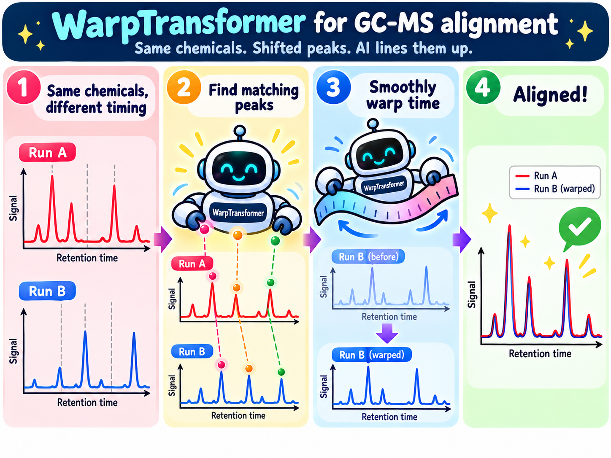

# alignment



**Test-Time Calibrated Warp Transformer for Within-Study GC-MS Retention Time Alignment**

Jesse Wood, Bach Nguyen, Bing Xue, Mengjie Zhang, Kevin Shedlock, Alastair B. Ross, and Daniel Killeen.
*IEEE Transactions on Artificial Intelligence*, submitted 2026.

A learned warp model for aligning GC-MS chromatograms across independently acquired
batches of the same study. It is calibrated at test time using a small set of spectral
anchor pairs.

`ChromaWarpTransformer` is pretrained on synthetic GC-MS chromatograms with known
displacement fields. At test time it is fine-tuned for 500 gradient steps using 4–8
RANSAC-filtered *m/z* cosine anchor pairs. TIC Pearson correlation is used only for
evaluation and is never seen during pretraining or calibration. This avoids the
objective–metric coupling of correlation optimised warping (COW), which directly
maximises the evaluation metric.

## Headline results

> **Superseded (2026-10-11).** The numbers in this section and under *Results* come from v1:
> data binned by scan index (which put a different time on each bin in different batches),
> peaks on the normalised TIC, two mixed time axes, and an approximate anchor loss. They
> will be replaced after the full rerun with the fixed code (`run.md`, section D).

Results on four drifted cross-batch pairs from a four-batch fish oil GC-MS dataset:

- **Largest TIC r gain on every pair.** The WarpTransformer improves mean TIC Pearson r by
  **+0.502 to +0.632** over unaligned. COW-TIC improves it by +0.431 to +0.562 and
  icoshift by +0.088 to +0.132.
- **Very few anchors suffice.** Calibration needs only 4–8 RANSAC spectral anchor pairs.
- **Pretraining helps most when anchors are sparse.** It adds +0.025 to +0.092 TIC r over
  random initialisation, with the largest gain at 4 anchors. It also reduces warp
  overshoot by up to 0.7 min.
- **Silhouette changes are small.** Study silhouette changes are ≤ +0.030 in absolute
  terms and not systematically larger than those of competing methods. Jan 2016 × Apr 2016
  is the exception (see below).

## Method

### Alignment pipeline

All methods share a common six-step pipeline. Only step 5 (warp fitting) differs between
methods.

1. **Peak detection.** Find local maxima of the **raw** TIC (compound abundance) above its
   80th-percentile intensity, with a minimum separation of 5 bins (`scipy.signal.find_peaks`),
   and keep the 30 highest.
2. **m/z fingerprinting.** Take the 3-bin mean spectrum (peak bin ±1) and L2-normalise it
   to a 1000-dim fingerprint.
3. **Peak matching.** Match peaks by cosine similarity under a time-window constraint.
   Hungarian assignment gives one-to-one matches, with an adaptive similarity threshold.
4. **RANSAC filtering.** Remove geometric outliers (straight line, 3-bin residual, minimum 2
   inliers) and keep the longest subset in elution order (longest increasing subsequence).
   For calibration, anchors from three batch-A samples are pooled (median per bin), then
   drift outliers (> 1.5 s.d.) and anchors implying an implausible local slope (outside
   0.5–2) are dropped. Every stage's anchor count is reported (`src/anchors.py`).
5. **Warp fitting.** Fit a monotone warp through the inlier anchors. Methods differ here.
6. **TIC resampling.** Resample the query TIC onto the reference time axis.

### ChromaWarpTransformer

`ChromaWarpTransformer` (`src/warp_transformer.py`) takes all N chromatograms
`[N, T=200, M=1000]` at once. It predicts a monotone displacement field per sample,
aligning every sample to a shared consensus RT frame rather than to a fixed reference.
At inference, samples from batches A and B are stacked into `[N_A + N_B, T, M]`.

The model has the following components:

- **Input projection.** Projects inputs to d = 128. A learned **study embedding** encodes
  which batch (A or B) each sample comes from.
- **Local RT attention.** Self-attention along the RT axis within each sample.
- **Global cross-sample attention.** Self-attention across the N samples at each RT bin,
  so each sample sees where the same compound elutes in the rest of the batch.
- **Monotone warp head.** Increments δ(t) = softplus(u(t) + log(e − 1)) (so δ = 1 at u = 0)
  are summed from a per-sample start offset predicted by a second head. The warp is strictly
  monotone and **neither end is pinned**, so drift at the start or end of the run can be
  represented. Both heads are **zero-initialised**, so an untrained model is exactly the
  identity. (A pretrained model starts from whatever warp it predicts; scripts 06 and 08
  report the starting warp magnitudes.)
- **Differentiable resampling.** The warp is applied by linear interpolation, clamped to the
  run.
- **Anchor loss.** A compound at batch-A bin r and batch-B bin q must reach the same consensus
  bin: w_B(w̄_A⁻¹(r)) = q, with w̄_A the mean batch-A warp (`anchor_loss_exact`).

### Synthetic pretraining

Script: `02_train_warp_transformer.py`. No real fish oil data and no TIC correlation are
used. The synthetic data is generated as follows:

- FAME peak positions and intensities are sampled from distributions matched to the fish
  oil dataset.
- A smooth random displacement field is applied, with max drift ±25 bins (±5.6 min).
- Gaussian peaks (σ = 2.5 bins), exponential baseline noise and global intensity scaling
  are added.
- The model is trained for 10,000 steps to predict the known displacement field.

### Test-time calibration

The model is calibrated with 500 Adam steps per batch pair. Anchors are extracted from
N = 3 batch-A samples matched against batch-B[0].

- **Relative anchor MSE.** For each anchor pair (q, r) with drift d = q − r, the loss is
  `(w_A(r) − mean_B w_B(r) − d)²`. The loss supervises the *inter-batch* warp difference,
  because the absolute consensus frame is free.
- **Smoothness.** The loss is λ · mean over samples of Var(warp velocity), with λ = 0.05.
  It penalises uneven velocity without forcing identity speed.

The setting is **transductive**: reported metrics are computed over all A×B pairs,
including the calibration samples. This is not metric leakage, because the only
supervision signal is *m/z* spectral cosine similarity.

### Baselines

| Method | Description |
|---|---|
| Unaligned | No alignment; lower bound |
| icoshift | 10 equal intervals; integer FFT cross-correlation shift per interval (max ±20 bins, ±4.5 min); piecewise-constant |
| COW-TIC | Dynamic programming over 4 segments, nodes free within ±22 bins (±5.0 min); maximises summed Pearson TIC r, the same quantity used for evaluation |
| Raw cosine PCHIP | Same RANSAC anchor pipeline, with a direct PCHIP interpolation through the inliers; no neural component |

## Data setup

Raw data is excluded from version control (`data/**` in `.gitignore`).
Fish oil GC-MS chromatograms should be placed under `data/fish_oil/`:

```
data/
  fish_oil/
    batch_sep2015/chroma/   {sample_id}.npz   (36 samples)
    batch_jan2016/chroma/                     (26 samples)
    batch_apr2016/chroma/                     (10 samples)
    batch_jul2016/chroma/                     (16 samples)
```

Each `.npz` holds `chroma` ([200, 1000] float32: sqrt and L2-normalised per bin) and `tic_raw`
([200] float32: summed raw intensity of each bin's apex scan). Runs are binned by **retention
time** on a fixed 0–45 min grid of 0.225-min windows (bin i covers [0.225 i, 0.225 (i+1)) min),
keeping the highest-TIC scan per window. Sep 2015 and Jan 2016 runs start acquiring at
5.0 min, Apr and Jul 2016 runs at 3.0 min (`results/scan_time_audit.txt`, script 04), so their
first 22 or 13 bins are empty.

## Training

```bash
python scripts/02_train_warp_transformer.py   # pretrain on synthetic GC-MS warps
```

The checkpoint is written to `checkpoints/warp_transformer_v2.pt` (excluded from git), with a
`.txt` report of the settings, library and final loss. v1 checkpoints pinned both warp ends
and cannot be loaded by the current model. Analysis scripts default to `--device cpu`
(bit-reproducible under a seed).

## Evaluation

```bash
python scripts/06_align_testtime_calib.py     # WarpTransformer + anchor calib, Raw cosine PCHIP
python scripts/05_literature_baselines.py     # COW-TIC and icoshift
python scripts/08_ablate_pretrain.py          # pretrained vs random-init ablation
```

Pass `--study-a` and `--study-b` (paths relative to `data/`) to select a batch pair, for
example `--study-a fish_oil/batch_sep2015 --study-b fish_oil/batch_jul2016`.

### Script order

The scripts are numbered in the order they run; each depends only on lower-numbered ones.
Paper runs use `--device cpu --ckpt checkpoints/warp_transformer_baseline.pt` and seeds 0–4.

| Script | Purpose | Needs |
|---|---|---|
| `01_download_pretrain_data.py` | MoNA EI-MS spectra for synthetic pretraining | — |
| `02_train_warp_transformer.py` | Pretrain the WarpTransformer on synthetic warps | 01 |
| `03_preprocess_fish_oil_batches.py` | Raw fish-oil exports → per-batch `chroma` + `tic_raw` | raw data |
| `04_audit_fish_oil_samples.py` | Account for every sample not in the four batches | 03 |
| `05_literature_baselines.py` | icoshift and COW-TIC, per batch pair | 03 |
| `06_align_testtime_calib.py` | WarpTransformer + anchor calibration, per pair and seed | 02, 03 |
| `07_pchip_pooled_anchors.py` | PCHIP through the WarpTransformer's pooled anchors | 05, 06 |
| `08_ablate_pretrain.py` | Pretrained vs random-init calibration, per pair and seed | 02, 03 |
| `09_mechanism_ablation.py` | Where the gain over a spline comes from (seed 0) | 05–07 |
| `10_heldout_anchor_error.py` | Leave-one-anchor-out RT error at known compounds | 05, 06, 09 |
| `11_within_batch_ceiling.py` | Within-batch TIC r: an upper reference for TIC r | 03 |
| `12_significance_tests.py` | Paired Wilcoxon tests with Holm correction, across seeds | 05–07 |
| `13_aggregate_seeds.py` | Mean ± s.d. over seeds for the tables (`seed_summary.txt`) | 05–08 |
| `14_generate_figures.py` | Paper figures | 05–07 |

Unused earlier scripts are in `scripts/archive/`.

### Metrics

- **TIC r.** Mean pairwise Pearson r between aligned query and reference TICs over all
  A×B sample pairs, on the common acquisition window (bins 22–199, 5.0–45 min; shared empty
  bins would inflate r). Higher is better. This is the primary metric, and it is also what
  COW-TIC optimises directly. Reported for the normalised TIC and the raw TIC (the same warps
  applied to `tic_raw`).
- **Study sil.** Study-label silhouette in PCA-50 space of per-*m/z* maximum-intensity
  projections. Lower means less batch separation. This projection is largely RT-invariant,
  so study sil is a **secondary diagnostic**, not a direct measure of compound-level
  alignment.
- **Warp mag.** Mean |w(t) − t| in minutes.

Significance is assessed with two-sided paired Wilcoxon signed-rank tests on per-pair
TIC r. Main results are means ± s.d. over five calibration seeds on CPU (script 13).

## Tests

```bash
python3.11 -m pytest -m "not slow"     # unit tests, ~10 s
python3.11 -m pytest                   # + end-to-end runs of scripts 05–14 on synthetic data, ~5 min
```

Tests marked `real` check the real data under `data/fish_oil` and are skipped without it.
`ALIGNMENT_ROOT` relocates `data/`, `results/` and `checkpoints/`; `ALIGNMENT_CALIB_STEPS`
shortens calibration (tests only).

## Results

> **Superseded (2026-10-11).** The numbers in this section come from v1:
> data binned by scan index (which put a different time on each bin in different batches),
> peaks on the normalised TIC, two mixed time axes, and an approximate anchor loss. They
> will be replaced after the full rerun with the fixed code (`run.md`, section D).

### Batch-pair screening

All six pairwise batch combinations were considered. Pairs with **unaligned TIC r > 0.5**
are excluded because they show no meaningful RT drift to correct. The threshold was set
on the unaligned baseline before any alignment method was run.

| Excluded pair | Unaligned TIC r | COW-TIC warp mag |
|---|---|---|
| Sep 2015 × Jan 2016 | 0.815 | 0.025 min |
| Apr 2016 × Jul 2016 | 0.900 | 0.038 min |

On these temporally adjacent pairs, every method was flat or regressed TIC r. COW-TIC was
the exception, with marginal gains of +0.013 and +0.003.

The four retained pairs (unaligned TIC r 0.066–0.128) form the main evaluation:

| Pair | Samples (A × B) | Total pairs | Anchors | Unaligned TIC r |
|---|---|---|---|---|
| Sep 2015 × Jul 2016 | 24 × 14 | 336 | 8 | 0.066 |
| Sep 2015 × Apr 2016 | 24 × 10 | 240 | 5 | 0.072 |
| Jan 2016 × Jul 2016 | 26 × 14 | 364 | 5 | 0.118 |
| Jan 2016 × Apr 2016 | 26 × 10 | 260 | 4 | 0.128 |

### Cross-batch alignment (fish oil GC-MS)

All pairwise method comparisons within each batch pair are significant at p < 0.001.

**Sep 2015 × Jul 2016** (n = 336, 8 anchors; largest drift)

| Method | TIC r | Δ unaligned | Study sil | Warp mag |
|---|---|---|---|---|
| Unaligned | 0.066 | — | 0.230 | — |
| icoshift | 0.154 | +0.089 | 0.240 | 0.545 min |
| Raw cosine PCHIP | 0.551 | +0.485 | 0.245 | — |
| COW-TIC | 0.606 | +0.540 | 0.243 | 3.030 min |
| **WarpTransformer + calib** | **0.698** | **+0.632** | 0.231 | 2.492 min |

**Sep 2015 × Apr 2016** (n = 240, 5 anchors)

| Method | TIC r | Δ unaligned | Study sil | Warp mag |
|---|---|---|---|---|
| Unaligned | 0.072 | — | 0.157 | — |
| icoshift | 0.160 | +0.088 | 0.181 | 0.723 min |
| Raw cosine PCHIP | 0.477 | +0.406 | 0.170 | — |
| COW-TIC | 0.634 | +0.562 | 0.178 | 3.061 min |
| **WarpTransformer + calib** | **0.681** | **+0.609** | 0.178 | 3.154 min |

**Jan 2016 × Apr 2016** (n = 260, 4 anchors)

| Method | TIC r | Δ unaligned | Study sil | Warp mag |
|---|---|---|---|---|
| Unaligned | 0.128 | — | 0.025 | — |
| icoshift | 0.249 | +0.121 | 0.030 | 0.301 min |
| Raw cosine PCHIP | 0.522 | +0.395 | 0.016 | — |
| COW-TIC | 0.558 | +0.431 | 0.020 | 2.277 min |
| **WarpTransformer + calib** | **0.629** | **+0.502** | 0.055 | 3.134 min |

**Jan 2016 × Jul 2016** (n = 364, 5 anchors)

| Method | TIC r | Δ unaligned | Study sil | Warp mag |
|---|---|---|---|---|
| Unaligned | 0.118 | — | 0.108 | — |
| icoshift | 0.251 | +0.132 | 0.104 | 0.255 min |
| Raw cosine PCHIP | 0.546 | +0.428 | 0.104 | — |
| COW-TIC | 0.567 | +0.449 | 0.107 | 2.282 min |
| **WarpTransformer + calib** | **0.620** | **+0.502** | 0.112 | 3.112 min |

### Key observations

- **The WarpTransformer achieves the highest TIC r on all four pairs.** It beats COW-TIC
  by +0.047 to +0.092 TIC r (8–17% larger Δ) and icoshift by 3.8–7.1× in Δ. Its per-pair
  TIC r distribution is the highest and narrowest of all methods in every condition.
  COW-TIC shows a longer lower tail.
- **Silhouette changes are small, with one exception.** WarpTransformer Δsil ranges from
  +0.001 to +0.021 on three pairs. On Jan 2016 × Apr 2016 it is **+0.030**, the highest of
  any method on that pair. That pair has the fewest anchors (4) and the largest
  WarpTransformer warp (3.134 min). Raw cosine PCHIP (0.016) and COW-TIC (0.020) both fall
  below baseline there. This is a limitation of the method on sparse-anchor pairs.
- **COW-TIC's silhouette behaviour is inconsistent.** It rises above baseline on the two
  Sep-batch pairs (+0.013, +0.021) despite TIC r gains comparable to the WarpTransformer.
  It falls slightly below baseline on the two Jan-batch pairs.
- **icoshift cannot capture nonlinear drift.** Its warp magnitudes are 0.255–0.723 min,
  against 2.3–3.2 min for COW-TIC and the WarpTransformer. Its gains (+0.088 to +0.132)
  are the smallest of all non-trivial methods. The 2–3 min non-uniform drift between
  batches needs a flexible warp.

### Ablation: does pretraining matter?

The same 500-step calibration was run from the pretrained checkpoint and from a random
initialisation with identical architecture. Both start from an identity warp because of
the zero-initialised warp head. Ablation runs use a fixed seed and a single pass, so
pretrained TIC r differs from the main tables by ≤ 0.023, which is within run-to-run
variance.

| Pair | Anchors | Unaligned | Random init | Random warp mag | Pretrained | Pretrained warp mag | Pretraining Δ |
|---|---|---|---|---|---|---|---|
| Sep 2015 × Jul 2016 | 8 | 0.066 | 0.641 | 2.8 min | **0.705** | 2.5 min | **+0.064** |
| Sep 2015 × Apr 2016 | 5 | 0.072 | 0.621 | 1.4 min | **0.672** | 1.1 min | **+0.051** |
| Jan 2016 × Apr 2016 | 4 | 0.128 | 0.527 | 1.6 min | **0.619** | 0.9 min | **+0.092** |
| Jan 2016 × Jul 2016 | 5 | 0.118 | 0.572 | 2.4 min | **0.597** | 2.1 min | **+0.025** |

- **Calibration accounts for most of the gain.** Calibration alone (random init) gives
  +0.399 to +0.575 over unaligned.
- **Pretraining adds a consistent margin** of +0.025 to +0.092. The margin is largest at
  4 anchors, where pretraining also cuts warp overshoot from 1.6 to 0.9 min. This suggests
  pretraining acts as implicit regularisation toward plausible warp shapes when anchors
  are sparse. The small margin on Jan × Jul (5 anchors) shows that drift difficulty
  matters, not just anchor count.
- **Pretraining speeds and stabilises convergence.** On Sep × Jul, the pretrained model
  starts at a lower loss (≈ 75 vs ≈ 175). It reaches a stable plateau (r ≈ 0.70) by about
  step 50. The random-init model plateaus lower (r ≈ 0.62) with larger oscillations.

## Limitations

- The method is evaluated on a single fish oil dataset across four batches.
  Generalisation to other matrices, instruments, column chemistries or non-FAME analyses
  is untested.
- The synthetic pretraining distribution is tuned to this dataset's drift range and
  spectral characteristics.
- Study silhouette is a proxy for batch integration. Compound identity confirmed by MS/MS
  or authentic standards would be a stronger measure.

## Exploration

`notebooks/01_explore_alignment.ipynb` walks through the full alignment pipeline. It
covers peak detection, *m/z* fingerprint extraction, Hungarian matching, piecewise-linear
warping, FAME library identification against MoNA, and encoder comparisons.

## Acknowledgement

Supported by the School of Engineering and Computer Science at Victoria University of
Wellington, the Bioeconomy Science Institute, and the Hiringa te Mahara pod of the
Abundant Intelligences research programme.